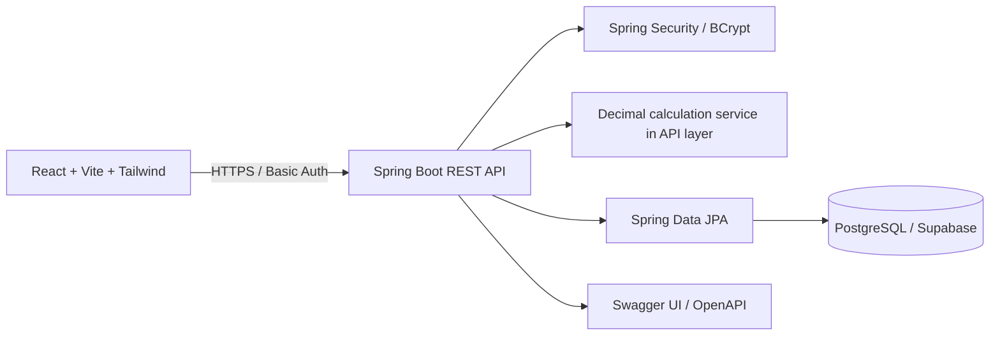
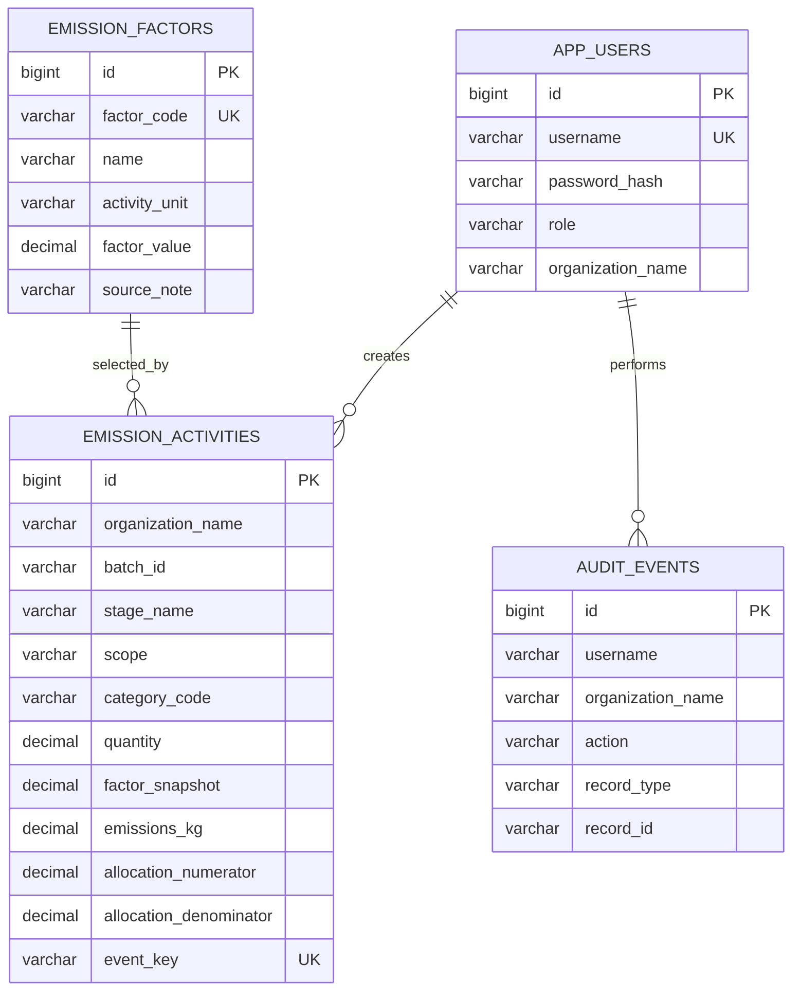

# Carbon Calculator — Working Guide (PostgreSQL edition)

## Purpose and limitations
This is a functional prototype for recording activities and estimating emissions. It is not a certified inventory. The four included factor rows are illustrative demo values and are not represented as verified Climatiq factors. For an evaluator-facing inventory, select suitable accessible factors from the current Climatiq Data Explorer, preserve their license/terms and provenance, and replace these demo rows.

## Architecture

Frontend deployments use Vercel. The Spring Boot container runs on Render. Persistent relational data is stored in PostgreSQL (Supabase supported). The frontend receives only the backend base URL; database credentials belong only in backend environment variables.

## Current relational model

The assignment's complete target schema additionally calls for facilities, products, batches, transfers, allocations, factor versions, reporting periods, calculation revisions and a unique physical-event ledger. Those are not fully implemented in this prototype.

## Roles and permissions
- **ADMIN:** can inspect all activity and audit rows, and can create activities for organizations.
- **STAKEHOLDER:** can create records only for their own organization and sees their own organization's activities and summary rows.
- **REVIEWER:** read-only activity/report access; cannot create activities.

The backend enforces role checks and compares a stakeholder's organization to the requested organization on create. The UI uses `/api/me` to populate the organization field. Basic authentication is suitable only for a controlled demonstration over HTTPS; use a production-grade token/session setup and rate limiting for production.

## End-to-end workflow
1. Sign in with a seeded demo account.
2. Frontend fetches category choices, factor catalogue, permitted activities and `/api/me`.
3. Open **Record an activity**, select a scope/category, choose a factor, enter positive quantity, unit and allocation numerator/denominator.
4. Optionally enter a stable event key for the physical event and a method/assumptions note.
5. Backend checks role/organization, validates scope/category, unit match and allocation ratio, snapshots factor value, calculates kg CO2e with decimal arithmetic, persists the activity and writes an audit event.
6. Refresh the activity ledger and load the batch summary.

## Calculation and interpretation
`kg CO2e = activity quantity × factor snapshot × (allocation numerator ÷ allocation denominator)`.
The allocation ratio is capped at 100% per record. If a stable event key is provided, the API rejects another activity with the same key. Do not enter both fuel-based and tonne-kilometre estimates for the same freight leg. A unique event key is only a duplicate-entry guard; the complete cross-organization event/allocation ledger is still a known gap.

The current code requires the submitted unit to exactly match the factor unit. It does not convert kg to tonnes, calculate tonne-kilometres from shipped mass and distance, convert individual gases using GWP, or produce Scope 2 location/market alternatives. Scope 3 category choices exist, but the category status endpoint marks verified data as unavailable pending proper factor configuration.

## Deployment
1. Provision PostgreSQL and copy its actual JDBC connection details.
2. Deploy `carbon-calculator-backend/` to Render using the included Dockerfile.
3. Set `DB_URL`, `DB_USERNAME`, `DB_PASSWORD`, `CORS_ALLOWED_ORIGINS` and strong initial demo passwords.
4. Deploy `carbon-calculator-frontend/` to Vercel and set `VITE_API_BASE_URL` to the Render backend URL.
5. Set the exact Vercel origin in Render CORS and redeploy.
6. Test health, Swagger, login, activity creation, organization denial, category status and summary with Postman.

## Verification checklist
- [ ] Health endpoint returns UP.
- [ ] Swagger UI and OpenAPI JSON load.
- [ ] Admin, stakeholder and reviewer logins work with known passwords.
- [ ] Unauthenticated API request is rejected.
- [ ] Stakeholder cannot create for another organization.
- [ ] Reviewer cannot create activities.
- [ ] Negative/zero quantity and allocation > 100% are rejected.
- [ ] Calculation matches quantity × factor × allocation.
- [ ] Duplicate event key is rejected.
- [ ] Frontend is connected to deployed API and persistent PostgreSQL.
- [ ] Factor provenance and all remaining assignment gaps are disclosed.

Do not mark a checklist item as passed until tested against the actual deployment and retain screenshots/Postman results as evidence.
